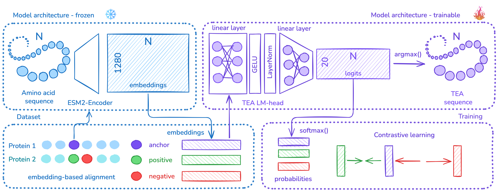

# The Embedded Alphabet (TEA)



This repository contains the code accompanying our pre-print: [Rewriting protein alphabets with language models](https://doi.org/10.1101/2025.11.27.690975). A web server with TEA converted datasets and search capabilities is available [here](https://pickybinders.org/tea).

## Installation

```bash
python -m pip install 'git+https://github.com/PickyBinders/tea.git@dev'
```
* Tested on Python 3.11, 3.12 and 3.13
* Typical installation time: 2min

## Sequence Conversion with TEA

The `tea_convert` command takes protein sequences from a FASTA file and generates an uppercase TEA FASTA. It uses the ESM2-650M model and the TEA checkpoint from the Hugging Face `dev` revision. Length-based batching is automatic, and conversion time is reported after completion. FASTA headers include mean residue entropy (`TH`, 0–1) and `tea_likelihood` (`TL`, matrix–Markov mean adjacent-transition log odds in bits; zero for single-residue sequences). Header values are rounded to three decimals.

```bash
tea_convert --fasta proteins.fasta --output proteins.tea.fasta
```

```text
usage: tea_convert [-h] --fasta FASTA --output OUTPUT
                   [--confidence-headers | --no-confidence-headers]
                   [--compile | --no-compile] [--compiler-cache COMPILER_CACHE]

options:
  -h, --help            show this help message and exit
  --fasta FASTA, -f FASTA
  --output OUTPUT, -o OUTPUT
  --confidence-headers, --no-confidence-headers
                        Append mean entropy (TH) and tea_likelihood (TL);
                        enabled by default
  --compile, --no-compile
                        Compile FP16 encoder blocks; enabled by default
  --compiler-cache COMPILER_CACHE
                        Shared compiler cache directory
```

Compilation requires PyTorch 2.8 or newer and a working C++/CUDA toolchain. The first conversion includes compilation; later processes reuse matching GPU/software compiler artifacts from `$XDG_CACHE_HOME/tea/compiler` (usually `~/.cache/tea/compiler`). Use `--compiler-cache PATH` to share this cache or `--no-compile` for eager FP16 inference.

Keep models loaded when converting several files:

```python
from tea.convert import Converter

converter = Converter()
converter.convert("first.fasta", "first.tea.fasta")
converter.convert("second.fasta", "second.tea.fasta")
```

### Using the huggingface model

```python
from tea.model import Tea
from tea.convert import _enable_fp32_rotary
from transformers import AutoTokenizer, AutoModel
from transformers import BitsAndBytesConfig
import torch
import re

tea = Tea.from_pretrained("PickyBinders/tea", revision="dev").to("cuda")
tea.eval()
device = next(tea.parameters()).device
tokenizer = AutoTokenizer.from_pretrained(
    "facebook/esm2_t33_650M_UR50D", revision="08e4846e537177426273712802403f7ba8261b6c"
)
bnb_config = BitsAndBytesConfig(
    load_in_4bit=True, bnb_4bit_quant_type="fp4", bnb_4bit_compute_dtype=torch.float16
)
esm2 = AutoModel.from_pretrained(
        "facebook/esm2_t33_650M_UR50D",
        revision="08e4846e537177426273712802403f7ba8261b6c",
        dtype=torch.float16,
        quantization_config=bnb_config,
        device_map={"": str(device)},
        add_pooling_layer=False,
    )
esm2.eval()
_enable_fp32_rotary(esm2)
sequence_examples = ["PRTEINO", "SEQWENCE"]
sequence_examples = [" ".join(list(re.sub(r"[UZOBJ]", "X", sequence))) for sequence in sequence_examples]
ids = tokenizer(sequence_examples, add_special_tokens=True, padding="longest")
input_ids = torch.tensor(ids['input_ids']).to(device)
attention_mask = torch.tensor(ids['attention_mask']).to(device)
with torch.no_grad():
    x = esm2(
        input_ids=input_ids, attention_mask=attention_mask
    ).last_hidden_state
    results = tea.to_sequences(embeddings=x.half().float(), input_ids=input_ids)
results
```

## Search with TEA against Many

In order to perform fast sequence searches and generate alignments, we recommend checking out STEAM. This tool is designed to leverage both TEA representations and standard amino acid information, allowing you to execute comprehensive dual-character sequence screening against large datasets. You can find the repository and usage instructions at [github.com/PickyBinders/steam](https://github.com/PickyBinders/steam).
